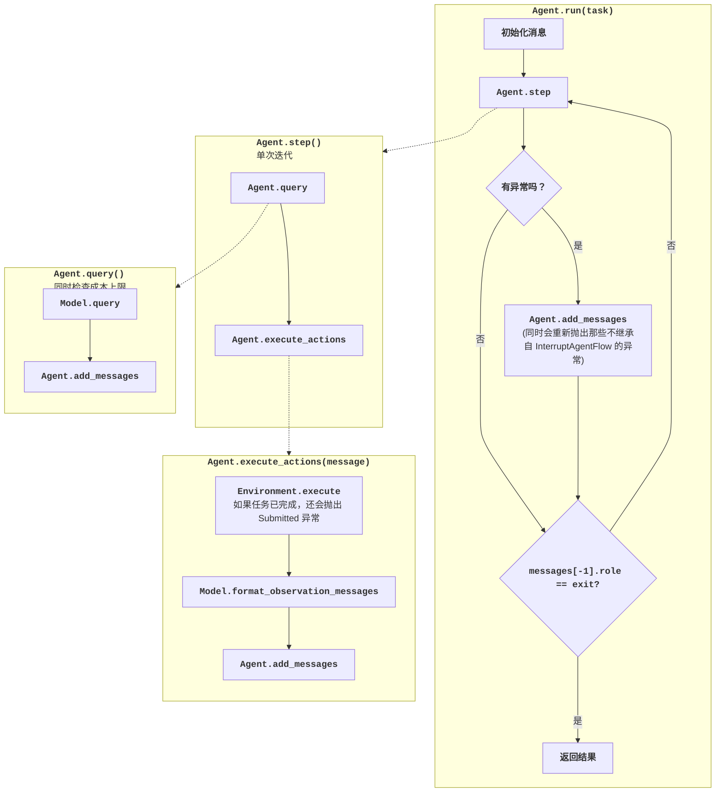

# 智能体控制流

!!! note "理解 AI 智能体的基础知识"

    我们最近还制作了一篇关于理解构建 AI 智能体基础知识的详细教程：[点此查看](https://minimal-agent.com)。

!!! abstract "理解默认智能体"

    * 本指南展示了默认智能体的控制流。
    * 看完之后，你就可以[混搭与扩展 mini](cookbook.md) 了

下图展示了 mini 智能体的控制流：



下面是实现该控制流的代码：

??? note "默认智能体类"

    - [在 GitHub 上阅读](https://github.com/swe-agent/mini-swe-agent/blob/main/src/minisweagent/agents/default.py)
    - [API 参考](../reference/agents/default.md)

    ```python
    --8<-- "src/minisweagent/agents/default.py"
    ```

本质上，`DefaultAgent.run` 会循环调用 `DefaultAgent.step`，直到智能体完成任务。

`step` 方法是智能体的核心：

```python
def step(self) -> list[dict]:
    return self.execute_actions(self.query())
```

它做了以下几件事：

1. 基于当前消息向模型请求响应（`DefaultAgent.query`，内部调用 `Model.query`）
2. 执行响应中的所有动作（`DefaultAgent.execute_actions`，对每个动作调用 `Environment.execute`）
3. 通过 `Model.format_observation_messages` 格式化观察消息
4. 把观察结果加入消息列表

下面是 `query`：

```python
def query(self) -> dict:
    # ... limit checks ...
    message = self.model.query(self.messages)
    self.add_messages(message)
    return message
```

以及 `execute_actions`：

```python
def execute_actions(self, message: dict) -> list[dict]:
    outputs = [self.env.execute(action) for action in message.get...
    return self.add_messages(*self.model.format_observation_messages(...))
```

有意思的地方在于我们如何处理错误情况和完成条件：
这里使用了继承自 `InterruptAgentFlow` 的异常。所有这些异常都携带会被加入轨迹的消息。

- 当智能体完成任务时，抛出 `Submitted`。例如，环境会检查命令输出是否以某个魔法字符串开头：

    ```python
    # 在 Environment.execute 中
    def _check_finished(self, output: dict):
        lines = output.get("output", "").lstrip().splitlines(keepends=True)
        if lines and lines[0].strip() == "COMPLETE_TASK_AND_SUBMIT_FINAL_OUTPUT":
            raise Submitted({"role": "exit", "content": ..., "extra": {...}})
    ```

- 当我们达到成本或步数上限时，抛出 `LimitsExceeded`
- 当语言模型的输出不符合预期格式时，抛出 `FormatError`
- 当动作执行时间过长时，抛出 `TimeoutError`
- 当用户中断智能体时，抛出 `UserInterruption`

`DefaultAgent.run` 方法会捕获这些异常，并通过把相应的消息加入消息列表来处理它们。循环会一直持续，直到加入一条 `role="exit"` 的消息。

```python
while True:
    try:
        self.step()
    except InterruptAgentFlow as e:
        self.add_messages(*e.messages)
    if self.messages[-1].get("role") == "exit":
        break
```

用异常来控制流程，比到处传递标志位和状态要简单得多，尤其是在扩展或子类化智能体时。


